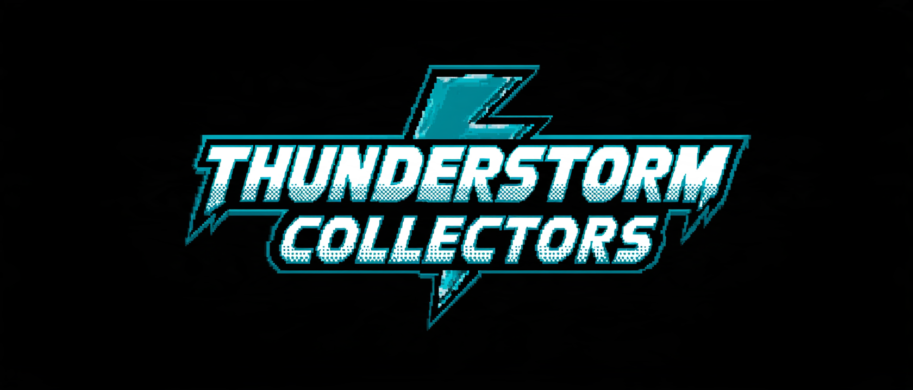

# THOR Thunderstorm Collector

Thunderstorm collectors provide lightweight, agentless file collection for analysis by the [THOR Thunderstorm](https://www.nextron-systems.com/thor-thunderstorm/) service. They walk configured directories on an endpoint, apply filters for file size, age, and type, and send matching file samples to the service.

Selective collection keeps endpoint workload and network traffic low. Metadata filters exclude unsuitable files without reading their full contents, and only matching samples are sent for analysis. For recurring collection, an age filter can focus each run on recently created or modified files. This supports frequent checks with broad coverage of relevant files within the configured scope, while the Thunderstorm service performs the computationally intensive analysis.

No collector installation or permanently running endpoint agent is required. Collectors run as portable binaries or standalone scripts using the required runtime and tools available on the endpoint. They can be started remotely through Ansible or another automation script, or placed on the endpoint and scheduled with cron or Windows Task Scheduler. Each invocation performs a collection pass and exits.

This repository provides a compiled Go collector, standalone script collectors, and assessment guides with collection configurations. Available filters, dependencies, and capabilities vary by collector.

## See How It Works

Why some systems cannot run a security agent, and how collectors bring their files to THOR Thunderstorm (a 93-second animation, no sound; the findings in it are illustrative):

https://github.com/user-attachments/assets/eb23f1e6-a6b0-4367-a5e1-fa2e93e4b331

## Choose a Scanning Approach

A Thunderstorm collector is one way to assess a system. Other options are a
native THOR scan, a remote filesystem scan using **SSHFS**, or offline analysis
of exported evidence. With SSHFS, THOR runs on an analysis workstation and reads
files through the source's SSH/SFTP service; no scanner or collector runs on
the source.

See [Choosing a THOR scanning approach](docs/SCANNING_APPROACHES.md) for the
comparison, an SSHFS example, licensing and evidence coverage. SSHFS is useful
for an ad-hoc assessment; scheduled Thunderstorm collectors are often a better
fit for recurring assessments.

For legacy AIX hosts, see the dedicated
[AIX on POWER7 SSHFS scanning guide](integration-guides/aix/aix-power7-sshfs-scanning.md),
with a quick path-allowlist scan for incident response and a thorough assessment
procedure covering root access, mount inventory and exclusions.

## Choose a Collector

| Starting point | When to use it | Documentation |
| --- | --- | --- |
| **Go collector** | Recommended for most general-purpose systems with a compatible OS and CPU architecture. Runs as a compiled binary without an installed Go runtime. | [Go usage, configuration, and platform compatibility](go/README.md) |
| **Script collectors** | Use an available scripting runtime when a compiled binary is impractical or you need to adapt the collection logic. | [Script selection and requirements](scripts/README.md#choosing-a-collector) |

The eight standalone scripts are organized into [Bash](scripts/bash/README.md), [POSIX sh / ash](scripts/ash/README.md), [Python](scripts/python/README.md), [Perl](scripts/perl/README.md), [PowerShell](scripts/powershell/README.md), and [Batch](scripts/batch/README.md) directories. Python and PowerShell each include a separate legacy variant.

For platform-specific selection, start with the **[collector recommendations](docs/COLLECTOR_RECOMMENDATIONS.md)**. They are ordered approximately by deployment prevalence, with related products grouped together:

- **Common systems and infrastructure:** Windows, Linux (including legacy kernels), macOS, VMware, Amazon Linux, and Kubernetes.
- **Edge appliances and NAS:** Cisco, Fortinet, Palo Alto Networks, Citrix NetScaler, F5, Check Point, Sophos, Ivanti, SonicWall, Synology, QNAP, pfSense/OPNsense, and OpenWrt.
- **Specialist platforms:** Nutanix, FreeBSD, OpenBSD, NetBSD, Solaris/illumos, and IBM AIX. The [binary inventory](docs/COLLECTOR_RECOMMENDATIONS.md#published-go-binary-targets) covers their available CPU targets, including ARM, MIPS, PowerPC, s390x, RISC-V, and LoongArch on applicable systems.

Prefer direct THOR scanning where the target is supported and local scanning is permitted. **THOR 11 is planned to add Windows ARM64 and Linux ARM64 support**, reducing the need for collectors on those supported systems. Collectors remain useful for legacy systems, appliances, other architectures, and central file-analysis workflows. See the [announcement and selection guidance](docs/COLLECTOR_RECOMMENDATIONS.md#direct-thor-scanning-and-arm64).

For VMware ESXi, use the [Python quick start](scripts/README.md#vmware-esxi-use-the-python-collector). For Citrix NetScaler, follow the [firmware/OS identification and collector selection steps](go/README.md#choose-a-collector-for-your-netscaler): use the dedicated binary for confirmed FreeBSD 8.4/amd64, or the [Bash assessment preset](emerging-threats/citrix-netscaler/README.md#option-2-existing-bash-collector) when its requirements are met.

## Emerging Threats: Assessment Guides and Collection Profiles

Use the [Emerging Threats guides](emerging-threats/README.md) to choose the files and directories to collect for a particular assessment. Profiles configure existing collectors; analysis uses the signatures installed on the Thunderstorm server.

| Assessment | Guide and configuration |
| --- | --- |
| **Citrix NetScaler** | [Broad assessment guide](emerging-threats/citrix-netscaler/README.md), with a [Go configuration](emerging-threats/citrix-netscaler/config.yml) and a [preset for the existing Bash collector](emerging-threats/citrix-netscaler/README.md#option-2-existing-bash-collector). |

These profiles are optional and downloaded separately from release packages. Each guide documents its scope, limits, execution requirements, and validation status. For Go, download the profile YAML using GitHub's **Download raw file** control and load it with `-t`; for Bash, apply the guide's preset to a deployment copy of the script.

## Download a Collector

Use [Releases](https://github.com/NextronSystems/thunderstorm-collector/releases) for published versions. Under **Assets**, select the package matching your OS and architecture: `amd64` means x86-64, and `arm64` means AArch64. Follow the documentation for that release.

- **Go packages** contain the executable and a default `config.yml`. Windows packages use ZIP; other platforms use `.tar.gz`. The standalone `config-<version>.yml` asset is an additional copy of that configuration.
- **Script assets** are individual, versioned files. Download the selected collector and check its runtime requirements. Each script runs independently; the repository's test harness is not required on the target.

**Release availability, 19 October 2026:** [v1.1.0](https://github.com/NextronSystems/thunderstorm-collector/releases/tag/v1.1.0) is the latest stable release. It includes the revised script collectors, additional legacy script variants, and dedicated NetScaler package. `master` may contain further changes; use the documentation matching your download.

- **Current scripts:** open the collector file linked in the [script selection table](scripts/README.md#choosing-a-collector) and use GitHub's **Download raw file** control, preserving the filename and extension. A single script is sufficient; no repository clone or build is needed. Follow its language guide for runtime requirements and settings.
- **NetScaler binary:** download `thunderstorm-collector-1.1.0-amd64-freebsd8-netscaler.tar.gz` and its `.sha256` file from the [v1.1.0 release assets](https://github.com/NextronSystems/thunderstorm-collector/releases/tag/v1.1.0), after checking the [target requirements](go/README.md#choose-a-collector-for-your-netscaler). For newer validation builds, follow the [CI artifact download steps](go/legacy/README.md#download-and-select). Local compilation is optional.
- **Published v1.1.0 Go binaries:** use the [matching Go guide](https://github.com/NextronSystems/thunderstorm-collector/blob/v1.1.0/go/README.md).

## Quick Start

For the **Linux amd64 Go package from v1.1.0**, download the archive from [Releases](https://github.com/NextronSystems/thunderstorm-collector/releases/tag/v1.1.0), extract it, and enter the package directory:

```sh
tar -xzf thunderstorm-collector-1.1.0-amd64-linux.tar.gz
cd thunderstorm-collector-amd64-linux
```

Start collecting by supplying just your Thunderstorm server's hostname or IP address:

```sh
./amd64-linux-thunderstorm-collector -s thunderstorm.example.internal
```

Replace `thunderstorm.example.internal` with your server. The collector automatically loads `config.yml` from the **current directory**, uses its file filters and limits, and uploads matching readable files. With the bundled configuration, collection starts at `/` on Linux/Unix or `C:\` on Windows; HTTP port **8080** and the local hostname as the source name are already the defaults. No other options or configuration edits are needed for that setup.

### Save the server once

For repeated use, add this line to the **existing** `config.yml`, keeping its filters and other settings:

```yaml
thunderstorm-server: thunderstorm.example.internal
```

Then, from the package directory, simply run:

```sh
./amd64-linux-thunderstorm-collector
```

The server setting can be supplied in YAML or with `-s`; it does not need to be specified in both places. Use a hostname or IP only; HTTPS and non-default ports have separate settings below.

### Optional preview

To see which files would be uploaded without contacting the server:

```sh
./amd64-linux-thunderstorm-collector --dry-run --debug
```

Normal runs upload files by default. `--dry-run=false` is only needed when overriding `dry-run: true` in a loaded configuration, such as a preview-enabled assessment profile.

### Command-line help

Run `--help` to list every available option and the effective defaults for your loaded configuration:

```sh
./amd64-linux-thunderstorm-collector --help
```

Reference output with built-in Unix defaults; the executable name and hostname are generalized below. The bundled `config.yml` overrides the file-size limit to **64 MiB**, while the built-in limit shown here is **100 MiB**.

```text
Usage: thunderstorm-collector [OPTION]...
      --all-filesystems              Ignore filesystem types. By default, the collector doesn't collect files from network mounts or special filesystems; with this flag, files are collected regardless of the underlying filesystem type.
      --ca strings                   Path to a PEM CA certificate that signed the HTTPS certificate of the Thunderstorm server.
                                     Specify multiple CAs by using this flag multiple times.
      --debug                        Print debugging information. Shows detailed information about each file processed, including why files are skipped or would be sent.
      --dry-run                      Collect files without actually sending them to Thunderstorm. Useful for testing and previewing what would be collected. Server connection is not required in dry-run mode.
      --exclude strings              Paths that should be excluded. Supports globbing with ?, * and **.
                                     Specify multiple excludes by using this flag multiple times.
                                     Example: --exclude C:\tools --exclude C:\Users\**\.git\**
  -e, --extension strings            File extensions that should be collected. If left empty, file extensions are ignored.
                                     Specify multiple extensions by using this flag multiple times.
                                     Example: -e .exe -e .dll
  -h, --help                         Show this help.
      --http-proxy string            Proxy that should be used for the connection to Thunderstorm.
                                     If left empty, the proxy is filled from the HTTP_PROXY and HTTPS_PROXY environment variables.
      --insecure                     Don't verify the Thunderstorm certificate if HTTPS is used.
  -l, --logfile string               Write the log to this file as well as to the console.
      --magic strings                Magic Header (bytes at file start) that should be collected, written as hex bytes. If left empty, magic headers are ignored.
                                     Specify multiple wanted Magic Headers by using this flag multiple times.
                                     Example: --magic 4d5a --magic cffa
  -a, --max-age string               Max age of collected files. Files with older modification date are ignored.
                                     Unit can be specified using a suffix: s for seconds, m for minutes, h for hour, d for day and defaults to days.
                                     Example: --max-age 10h
  -m, --max-filesize int             Maximum file size up to which files should be uploaded (in MB). (default 100)
  -p, --path strings                 Root paths from where files should be collected.
                                     Specify multiple root paths by using this flag multiple times. (default [/])
      --port int                     Port on the Thunderstorm Server to which files should be uploaded. (default 8080)
  -o, --source string                Name for this device in the Thunderstorm log messages. (default "HOSTNAME")
      --ssl                          If true, connect to the Thunderstorm Server using HTTPS instead of HTTP.
  -t, --template string              Process default scan parameters from this YAML file. (default "config.yml")
  -r, --threads int                  How many threads should upload files simultaneously. Set to 0 to use all available CPU cores, or use negative values to reserve cores (e.g., -2 = all cores except 2). (default 1)
  -s, --thunderstorm-server string   FQDN or IP of the Thunderstorm Server to which files should be uploaded.
                                     Examples: --thunderstorm-server my.thunderstorm, --thunderstorm-server 127.0.0.1
      --upload-synchronous           Whether files should be uploaded synchronously to Thunderstorm. If yes, the collector takes longer, but displays the results of all scanned files.
      --uploads-per-minute int       Delay uploads to only upload samples with the given frequency of uploads per minute. Zero means no delays.
```

Only the server address is required for uploads, either in `config.yml` or with `-s`. Other settings are optional. Command-line values override YAML settings. Long option names also serve as YAML keys, such as `thunderstorm-server`, `port`, and `path`; `--help` and `--template` are command-line controls only. List-valued settings use YAML lists, for example `path: ["/var/www", "/home"]`. See the [Go configuration guide](go/README.md#configuration-files) for examples and filter behavior.

These settings apply to the **Go collector**. Script collectors have their own defaults and option names; use the selected [language guide](scripts/README.md). For an assessment profile, follow its guide and load its configuration with `-t`.

## Product Integration Guides

[Product integration guides](integration-guides/README.md) describe deployment, networking, and recurring collection on particular systems, and list [related Nextron repositories](integration-guides/README.md#related-nextron-repositories) for container scanning, mail filtering, API clients, and test servers. The existing [ESXi 7 without Secure Boot guide](integration-guides/esxi/esxi7-wo-secure-boot.md) covers a persistent Python deployment. Start with the current [ESXi collector requirements and quick start](scripts/README.md#vmware-esxi-use-the-python-collector) before scheduling collection.

## Testing and Compatibility

- [Testing overview](docs/COLLECTOR_TESTING_OVERVIEW.md): automated checks, local HTTP/HTTPS test backends, runtime coverage, and commands for running focused tests.
- [Script acceptance report, 8 October 2026](docs/SCRIPT_COLLECTOR_ACCEPTANCE_2026-10-08.md): real-THOR results for the exact revisions and assets recorded there, plus remaining checks.
- [NetScaler compatibility and FreeBSD VM evidence](go/README.md#citrix-netscaler-and-freebsd-84): the tested legacy binary, OS versions, and the FreeBSD 14.3 ASLR note.

Automated checks and recorded VM/runtime tests have specific scopes. Confirm the collector and collection profile on the intended product and firmware; each guide identifies remaining target-system validation.

## Build or Extend a Collector

Downloaded binaries and standalone scripts can be run directly; building is optional. For source builds, follow the [Go build requirements](go/README.md#build-requirements). From the repository root, choose the target you need; these commands are independent:

```sh
make -C go           # Build the Go collector for the current platform
make release-scripts # Package individual script assets
make release         # Package all regular targets supported by the installed Go compiler, plus scripts
make help            # List available targets
```

A current-platform build writes its executable to `go/bin/`. To use the packaged filters, pass `-t go/config.yml` when running it from the repository root. Regular binary archives are created in `go/dist/`; versioned release assets are assembled locally in `release/`. `make release` prepares files locally; the tagged workflow below uploads them to a draft release. The dedicated NetScaler package has a separate [legacy build procedure](go/legacy/README.md). The [tagged-release workflow](.github/workflows/release.yml) builds both regular and legacy packages, verifies the required assets, and attaches them with checksums to a **draft release** after its required jobs succeed. A maintainer reviews the draft and publishes it separately in GitHub Releases.

To add a language or platform, follow the [collector construction guide](docs/COLLECTOR_CONSTRUCTION_GUIDE.md). It covers the upload protocol, optional features, resource limits, acceptance tests, and a reusable coding-agent assignment. The separate [thunderstormAPI Python library](https://github.com/NextronSystems/thunderstormAPI) is another resource for custom integrations.
