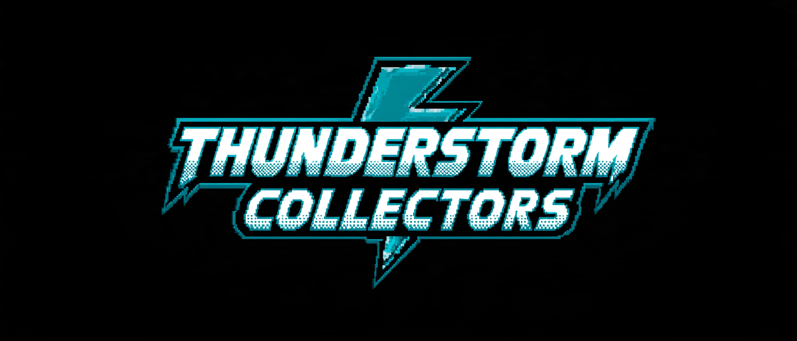

# THOR Thunderstorm Collector

Thunderstorm collectors send selected files from endpoints to the
[THOR Thunderstorm](https://www.nextron-systems.com/thor-thunderstorm/) service,
which analyzes them. Each run walks the configured directories, selects files by
size, age and type, uploads the matches and exits.


- **No agent:** a portable binary or a standalone script; nothing to install.
  Start it remotely, for example with Ansible, or schedule it with cron or
  Windows Task Scheduler.
- **Light on the source:** metadata filters skip unsuitable files without
  reading them. An age filter lets frequent runs send only new or changed files.
- **Heavy work on the server:** Thunderstorm does the analysis.

This repository contains the Go collector, standalone script collectors, a
prototype SFTP collector for systems on which nothing can run, and assessment
profiles.

## See How It Works

A 93-second animation, without sound, on why some systems cannot run a security
agent and how collectors bring their files to THOR Thunderstorm. The findings in
it are illustrative.

https://github.com/user-attachments/assets/eb23f1e6-a6b0-4367-a5e1-fa2e93e4b331

## Choose a Scanning Approach


**Where THOR can run and is permitted, run THOR:** only a native scan adds the
live system checks. Otherwise, pick the method that needs the least on the
source:

| Situation | Recommended | Alternative |
| --- | --- | --- |
| The system meets the standard THOR requirements, and THOR may run | THOR on the system | Go collector for frequent checks of new files between scans |
| A Windows version older than the standard THOR requirements | [THOR Legacy](https://thor-manual.nextron-systems.com/en/latest/usage/requirements.html#legacy-systems), with its license | [Go collector](go/README.md) |
| THOR does not support the system, but a Go binary or a script runtime can run | [Go collector](go/README.md) | [Script collector](scripts/README.md#choosing-a-collector) |
| Many systems with frequent checks of new or changed files | Go or script collector with an age filter | THOR on the system at longer intervals |
| Only SSH/SFTP is available; one complete assessment, as in incident response | [THOR over SSHFS](docs/SCANNING_APPROACHES.md#remote-filesystem-scans-with-sshfs) (Forensic Lab License) | [SFTP collector](sftp/README.md) |
| Only SSH/SFTP is available; repeated collection, many systems or slow links | [SFTP collector](sftp/README.md) (prototype) | THOR over SSHFS |
| No live access, an isolated network, or files only as a vendor export | [Exported evidence](docs/SCANNING_APPROACHES.md#offline-analysis-of-exported-evidence) scanned with THOR | Upload the exports with a collector on another system |

- **Reasons, licensing and coverage of each method:** [Choosing a THOR scanning approach](docs/SCANNING_APPROACHES.md)
- **Legacy AIX hosts:** [AIX on POWER7 SSHFS scanning guide](integration-guides/aix/aix-power7-sshfs-scanning.md)

## Choose a Collector

| Collector | When to use it | Documentation |
| --- | --- | --- |
| **Go collector** | Most systems with a compatible OS and CPU. A compiled binary; no Go runtime needed. | [Go collector guide](go/README.md) |
| **Script collectors** | A compiled binary is impractical, or you want to adapt the logic. Bash, POSIX sh / ash, Python, Perl, PowerShell and Batch. | [Script chooser](scripts/README.md#choosing-a-collector) |
| **SFTP collector** (prototype) | Nothing can run on the source, but SSH with SFTP is available. Runs on another system and pulls the selected files; the source needs no route to Thunderstorm. | [SFTP collector guide](sftp/README.md) |

- **By product or platform** (Windows, Linux, macOS, VMware, edge appliances,
  NAS, BSD, Solaris, AIX and more): [collector recommendations](docs/COLLECTOR_RECOMMENDATIONS.md),
  including the [CPU targets of the published binaries](docs/COLLECTOR_RECOMMENDATIONS.md#published-go-binary-targets).
- **VMware ESXi:** [Python collector quick start](scripts/README.md#vmware-esxi-use-the-python-collector).
- **Citrix NetScaler:** [identify the firmware and OS first](go/README.md#choose-a-collector-for-your-netscaler),
  then use the dedicated binary (FreeBSD 8.4 / amd64) or the
  [Bash assessment preset](emerging-threats/citrix-netscaler/README.md#option-2-existing-bash-collector).
- **ARM64:** THOR 11 is planned to add Windows ARM64 and Linux ARM64 support,
  which reduces the need for collectors on those systems. [Details](docs/COLLECTOR_RECOMMENDATIONS.md#direct-thor-scanning-and-arm64)

## Emerging Threats: Assessment Profiles

[Assessment profiles](emerging-threats/README.md) tell an existing collector
which files to collect for a particular threat. Analysis uses the signatures on
the Thunderstorm server.

| Assessment | Guide and configuration |
| --- | --- |
| **Citrix NetScaler** | [Assessment guide](emerging-threats/citrix-netscaler/README.md), with a [Go configuration](emerging-threats/citrix-netscaler/config.yml) and a [Bash preset](emerging-threats/citrix-netscaler/README.md#option-2-existing-bash-collector) |

Profiles are not part of the release packages. For Go, download the YAML with
GitHub's **Download raw file** button and load it with `-t`. For Bash, apply
the preset to a copy of the script.

## Download a Collector

Download from [Releases](https://github.com/NextronSystems/thunderstorm-collector/releases).
Under **Assets**, pick your OS and architecture (`amd64` = x86-64,
`arm64` = AArch64), and use the documentation of that release.

| Package | Contents |
| --- | --- |
| **Go** | Executable and default `config.yml`; ZIP on Windows, `.tar.gz` elsewhere. `config-<version>.yml` is a separate copy of that file. |
| **Scripts** | One versioned file per collector. The target needs only that file and its runtime, not the test harness. |
| **NetScaler** | `thunderstorm-collector-<version>-amd64-freebsd8-netscaler.tar.gz` with a `.sha256` file. Check the [target requirements](go/README.md#choose-a-collector-for-your-netscaler) first. |
| **SFTP** (releases after v1.1.0) | Linux binary for amd64 or arm64 and its README. Runs on the Thunderstorm host or another system with SSH access to the sources. |

> [!NOTE]
> **v1.1.0** is the latest release. `master` may contain newer changes:
> - **Current scripts:** open the file from the [script chooser](scripts/README.md#choosing-a-collector)
>   and use **Download raw file**, keeping the filename.
> - **Newer NetScaler builds:** follow the [CI artifact steps](go/legacy/README.md#download-and-select).
> - **v1.1.0 Go binaries:** use the [v1.1.0 Go guide](https://github.com/NextronSystems/thunderstorm-collector/blob/v1.1.0/go/README.md).

## Quick Start

For the Linux amd64 Go package from v1.1.0:

```sh
tar -xzf thunderstorm-collector-1.1.0-amd64-linux.tar.gz
cd thunderstorm-collector-amd64-linux
./amd64-linux-thunderstorm-collector -s thunderstorm.example.internal
```

Replace `thunderstorm.example.internal` with your server. Nothing else is
needed:

- `config.yml` is loaded from the **current directory** and supplies the file
  filters and limits.
- Collection starts at `/` on Linux/Unix and `C:\` on Windows.
- Port **8080** and the local hostname as source name are the defaults.

**Save the server once:** add `thunderstorm-server: thunderstorm.example.internal`
to the existing `config.yml`. Then `./amd64-linux-thunderstorm-collector` needs
no options. Give a hostname or IP only; HTTPS and other ports have their own
settings.

**Preview without uploading:**

```sh
./amd64-linux-thunderstorm-collector --dry-run --debug
```

Normal runs upload. `--dry-run=false` is only needed to override `dry-run: true`
in a loaded configuration, such as an assessment profile.

### Command-line help

`--help` lists every option with the effective defaults of the loaded
configuration. Command-line values override YAML. Long option names are also
YAML keys (`thunderstorm-server`, `port`, `path`; lists as `path: ["/var/www", "/home"]`),
except `--help` and `--template`. See the [Go configuration guide](go/README.md#configuration-files).

These options apply to the Go collector only. Script collectors have their own;
see the [language guides](scripts/README.md).

<details>
<summary>Reference output with built-in Unix defaults</summary>

The executable name and hostname are generalized. The bundled `config.yml`
lowers the file-size limit to **64 MiB**; the built-in limit shown here is
**100 MiB**.

```text
Usage: thunderstorm-collector [OPTION]...
      --all-filesystems              Ignore filesystem types. By default, the collector doesn't collect files from network mounts or special filesystems; with this flag, files are collected regardless of the underlying filesystem type.
      --ca strings                   Path to a PEM CA certificate that signed the HTTPS certificate of the Thunderstorm server.
                                     Specify multiple CAs by using this flag multiple times.
      --debug                        Print debugging information. Shows detailed information about each file processed, including why files are skipped or would be sent.
      --dry-run                      Collect files without actually sending them to Thunderstorm. Useful for testing and previewing what would be collected. Server connection is not required in dry-run mode.
      --exclude strings              Paths that should be excluded. Supports globbing with ?, * and **.
                                     Specify multiple excludes by using this flag multiple times.
                                     Example: --exclude C:\tools --exclude C:\Users\**\.git\**
  -e, --extension strings            File extensions that should be collected. If left empty, file extensions are ignored.
                                     Specify multiple extensions by using this flag multiple times.
                                     Example: -e .exe -e .dll
  -h, --help                         Show this help.
      --http-proxy string            Proxy that should be used for the connection to Thunderstorm.
                                     If left empty, the proxy is filled from the HTTP_PROXY and HTTPS_PROXY environment variables.
      --insecure                     Don't verify the Thunderstorm certificate if HTTPS is used.
  -l, --logfile string               Write the log to this file as well as to the console.
      --magic strings                Magic Header (bytes at file start) that should be collected, written as hex bytes. If left empty, magic headers are ignored.
                                     Specify multiple wanted Magic Headers by using this flag multiple times.
                                     Example: --magic 4d5a --magic cffa
  -a, --max-age string               Max age of collected files. Files with older modification date are ignored.
                                     Unit can be specified using a suffix: s for seconds, m for minutes, h for hour, d for day and defaults to days.
                                     Example: --max-age 10h
  -m, --max-filesize int             Maximum file size up to which files should be uploaded (in MB). (default 100)
  -p, --path strings                 Root paths from where files should be collected.
                                     Specify multiple root paths by using this flag multiple times. (default [/])
      --port int                     Port on the Thunderstorm Server to which files should be uploaded. (default 8080)
      --response-timeout int         Seconds to wait for Thunderstorm's answer once a request has been sent. Zero selects the default: 120 seconds, or 1800 seconds with --upload-synchronous, where Thunderstorm scans the file before it answers.
      --server-wait int              Seconds to wait for Thunderstorm to come back after 3 files in a row could not be delivered. Meanwhile the collector polls /api/status; when the time runs out it stops and exits with status 1. Zero stops at once. (default 600)
  -o, --source string                Name for this device in the Thunderstorm log messages. (default "HOSTNAME")
      --ssl                          If true, connect to the Thunderstorm Server using HTTPS instead of HTTP.
  -t, --template string              Process default scan parameters from this YAML file. (default "config.yml")
  -r, --threads int                  How many threads should upload files simultaneously. Set to 0 to use all available CPU cores, or use negative values to reserve cores (e.g., -2 = all cores except 2). (default 1)
  -s, --thunderstorm-server string   FQDN or IP of the Thunderstorm Server to which files should be uploaded.
                                     Examples: --thunderstorm-server my.thunderstorm, --thunderstorm-server 127.0.0.1
      --upload-synchronous           Whether files should be uploaded synchronously to Thunderstorm. If yes, the collector takes longer, but displays the results of all scanned files.
      --uploads-per-minute int       Delay uploads to only upload samples with the given frequency of uploads per minute. Zero means no delays.
```

</details>

## Product Integration Guides

[Integration guides](integration-guides/README.md) cover deployment, networking
and recurring collection on particular systems, such as
[ESXi 7 without Secure Boot](integration-guides/esxi/esxi7-wo-secure-boot.md).
The index also lists [related Nextron repositories](integration-guides/README.md#related-nextron-repositories)
for container scanning, mail filtering, API clients and test servers.

## Testing and Compatibility

- [Testing overview](docs/COLLECTOR_TESTING_OVERVIEW.md): automated checks, test backends and how to run them.
- [Script acceptance report, 8 October 2026](docs/SCRIPT_COLLECTOR_ACCEPTANCE_2026-10-08.md): real-THOR results for the revisions recorded there.
- [NetScaler and FreeBSD compatibility](go/README.md#citrix-netscaler-and-freebsd-84): the tested legacy binary and OS versions.

Recorded tests cover specific revisions and systems. Test the collector and
profile on the intended product and firmware before relying on it.

## Build or Extend a Collector

Building is optional. For source builds, see the
[Go build requirements](go/README.md#build-requirements). From the repository
root:

```sh
make -C go           # Go collector for the current platform → go/bin/
make release-scripts # Versioned script assets
make release         # All regular targets the installed Go supports, plus scripts
make help            # List all targets
```

- Run a local build from the repository root with `-t go/config.yml` to use the
  packaged filters.
- Archives go to `go/dist/`; versioned release assets to `release/`.
- The dedicated NetScaler package has its own [legacy build procedure](go/legacy/README.md).
- Releases: the [tagged-release workflow](.github/workflows/release.yml) builds
  regular and legacy packages, checks them and attaches them with checksums to a
  **draft release**. A maintainer reviews and publishes it.

To build a collector for another language or platform, follow the
[collector construction guide](docs/COLLECTOR_CONSTRUCTION_GUIDE.md): upload
protocol, optional features, limits, acceptance tests and a reusable
coding-agent assignment. Server developers find the run start/end protocol in
[collection markers](docs/COLLECTION_MARKERS.md). For custom integrations, see
the [thunderstormAPI Python library](https://github.com/NextronSystems/thunderstormAPI).

Documentation changes follow the [documentation style guide](docs/DOCUMENTATION_STYLE.md).
