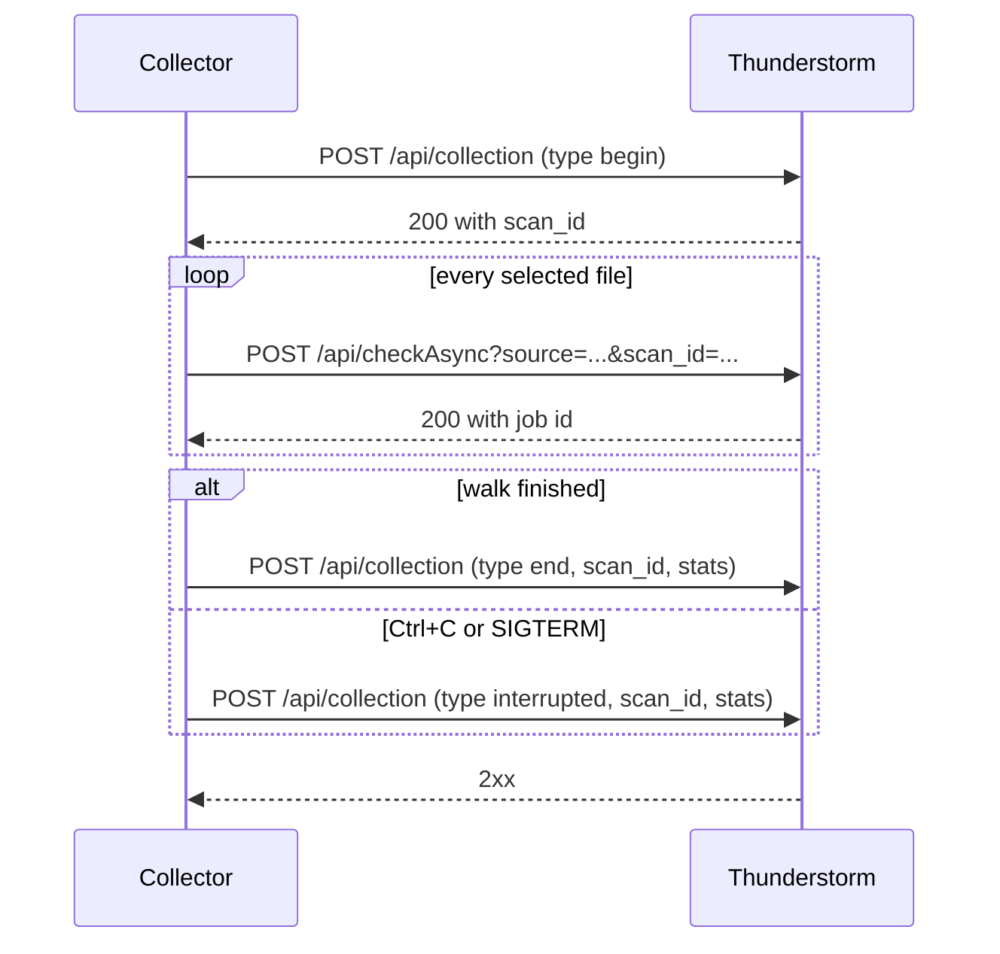

# Collection Markers: What the Collectors Send

Last reviewed: **6 November 2026**, against the collectors on `master`.

This document is for developers of the Thunderstorm service. It describes what
the collectors in this repository send to `POST /api/collection`, how they react
to each answer, and what a server can and cannot conclude from it. Collector
authors should follow
[section 3 of the construction guide](COLLECTOR_CONSTRUCTION_GUIDE.md#3-add-collection-markers-only-when-supported)
instead.

## Contents

- [Why Markers Exist](#why-markers-exist)
- [Support Today](#support-today)
- [One Run on the Wire](#one-run-on-the-wire)
- [Requests](#requests)
- [The Begin Answer](#the-begin-answer)
- [Uploads in a Run](#uploads-in-a-run)
- [How Collectors React to Answers](#how-collectors-react-to-answers)
- [When Markers Are Sent](#when-markers-are-sent)
- [What the Server Can Conclude](#what-the-server-can-conclude)
- [What a Server Must Do](#what-a-server-must-do)
- [Questions for the Server Design](#questions-for-the-server-design)
- [Testing](#testing)
- [History](#history)

## Why Markers Exist

When THOR scans a system, every log line of that scan carries the scan ID of
the run. Thunderstorm has no such run. A collector sends one file per request,
labeled only with a `source` value, which is usually the host name. A collector
started every night by cron sends the same `source` every night, and one run can
take minutes or days. The server cannot tell whether two samples came from the
same run, from consecutive runs, or from two runs that overlap.

Collection markers close that gap. A collector announces the start of a run,
receives a run ID from the server, attaches that ID to every upload of the run,
and reports the end of the run, or its interruption, together with its counters.

## Support Today

### Collectors

| Collector | Sends markers | `collector` value | Notes |
|---|---|---|---|
| [Bash](../scripts/bash/README.md) | Yes | `bash/0.5.0` | curl or GNU wget. Sends no `hostname` field. |
| [POSIX sh / ash](../scripts/ash/README.md) | Yes, with curl or GNU wget | `ash/0.5.0` | The netcat transport sends no markers. |
| [Python 3](../scripts/python/README.md) | Yes | `python3/0.2` | The only collector that sends `stats.in_flight`. |
| [Python 2](../scripts/python/README.md) | Yes | `python2/0.2` | Same marker code as Python 3. |
| [Perl](../scripts/perl/README.md) | Yes | `perl/0.3` | |
| [PowerShell 3+](../scripts/powershell/README.md) | Yes | `powershell3/0.3` | Also sends `interrupted` when it gives up on an unreachable server. |
| [PowerShell 2](../scripts/powershell/README.md) | Yes, if a JSON parser is available | `powershell2/0.3` | Needs .NET 3.5 `System.Web.Extensions`; without it, no markers. |
| [Windows Batch](../scripts/batch/README.md) | No | | Removed by design in March 2026. |
| [Go collector](../go/README.md) | Yes | `go` | Also adds `scan_id` to `/api/check` in synchronous mode. A failed begin does not stop the run. |
| [SFTP collector](../sftp/README.md) | Yes | `sftp` | `hostname` is the system that runs the collector, not the SFTP source. Same begin rule as Go. |

The version in a script's `collector` value follows that script's own version
number; Go and SFTP send no version. Treat the value as a label and do not
parse it.

### Servers

| Server | `POST /api/collection` | `scan_id` on uploads |
|---|---|---|
| THOR 10 Thunderstorm | Not implemented: HTTP 404, [recorded with THOR 10.7.30](SCRIPT_COLLECTOR_ACCEPTANCE_2026-10-08.md#what-these-results-do-not-establish) | Never sent, because begin fails with 404 |
| THOR 11 Thunderstorm | Planned | Planned |
| [thunderstorm-stub-server](https://github.com/Nextron-Labs/thunderstorm-stub-server) (test server) | Accepts begin, end and interrupted, returns a UUID, logs each marker | Ignored: every upload gets its own ID |

No server links uploaded samples to a run yet. That link is the server-side work.

## One Run on the Wire



A dry run sends no request at all, markers included.

## Requests

Every marker request is:

- `POST /api/collection` on the same scheme, host, port and TLS settings as the
  uploads, without authentication headers;
- a single JSON object in UTF-8 with `Content-Type: application/json`;
- sent with a client timeout of about 10 seconds;
- labeled with the same `source` string that the run's uploads carry in the
  `source` query parameter.

### Fields

| Field | Type | Present in | Sent by | Meaning |
|---|---|---|---|---|
| `type` | string | all | all | `begin`, `end` or `interrupted` |
| `source` | string | all | all | The run's source label: the host name by default, or the value the operator set. The uploads carry the same string. |
| `hostname` | string | all | all except Bash | The name of the machine that runs the collector, independent of `source`. For the SFTP collector, this is not the system it collects from. |
| `collector` | string | all | all | Collector name and version, see the table above |
| `timestamp` | string | all | all | Client clock in UTC, `YYYY-MM-DDTHH:MM:SSZ`, whole seconds |
| `scan_id` | string | end, interrupted | all | The ID from the begin answer. Absent when the run has none. |
| `stats` | object | end, interrupted | all | Run counters, see below |

No collector sends a `reason` field today. The stub server accepts one for
`interrupted`.

### Counters

| Key | Type | Meaning |
|---|---|---|
| `scanned` | integer | Candidate files the collector examined. Some collectors apply age or extension filters while listing, so the count is not "all files on the host". |
| `submitted` | integer | Files the server answered with 2xx. For `/api/checkAsync` this means queued, not analyzed. |
| `skipped` | integer | Candidates the collector's filters excluded, such as size, age, file type or exclusion lists. Which filters count here differs per collector. |
| `failed` | integer | Candidates that could not be read or uploaded after retries |
| `scan_errors` | integer | Directories or roots that could not be listed. A nonzero value means the walk was incomplete. |
| `elapsed_seconds` | integer | Seconds since the collector started |
| `in_flight` | string | Python only: the path being uploaded when the marker was built. In practice it only appears in `interrupted`. |

The collectors count candidates differently, so do not expect
`scanned = submitted + skipped + failed`.

### Examples

Begin, Python 3:

```json
{
  "type": "begin",
  "source": "web-01",
  "hostname": "web-01.example.org",
  "collector": "python3/0.2",
  "timestamp": "2026-11-06T02:00:00Z"
}
```

End, Bash (no `hostname`):

```json
{
  "type": "end",
  "source": "web-01",
  "collector": "bash/0.5.0",
  "timestamp": "2026-11-06T02:47:13Z",
  "scan_id": "6f1c2a9e-3b7d-4e55-9a0c-1d2e3f405162",
  "stats": {"scanned": 18240, "submitted": 912, "skipped": 41, "failed": 2,
            "scan_errors": 0, "elapsed_seconds": 2833}
}
```

Interrupted, Python 3, stopped with Ctrl+C during an upload:

```json
{
  "type": "interrupted",
  "source": "web-01",
  "hostname": "web-01.example.org",
  "collector": "python3/0.2",
  "timestamp": "2026-11-06T02:12:09Z",
  "scan_id": "6f1c2a9e-3b7d-4e55-9a0c-1d2e3f405162",
  "stats": {"scanned": 5120, "submitted": 260, "skipped": 9, "failed": 0,
            "scan_errors": 0, "elapsed_seconds": 729,
            "in_flight": "/var/www/html/upload.php"}
}
```

## The Begin Answer

A collector takes the run ID only from a 2xx answer whose body is a JSON object
with a top-level string field `scan_id`:

```json
{"scan_id": "6f1c2a9e-3b7d-4e55-9a0c-1d2e3f405162"}
```

The collector warns and runs without an ID when the body is not a JSON object,
or when `scan_id` is missing, null, a number, an empty string or only present in
a nested object. Bash, ash, Go and SFTP also ignore IDs longer than 256 bytes
and IDs containing control characters. Bash, ash, Python, Go and SFTP ignore
begin bodies larger than 64 KiB. Bash and ash also ignore duplicate `scan_id`
keys and JSON nested deeper than 32 levels.

All other fields of the begin answer are ignored, and so is the body of the
answers to end and interrupted. Clients do not check the response
`Content-Type`.

## Uploads in a Run

After a begin answer with a usable ID, every upload of the run carries it as a
second, percent-encoded query parameter. Retries of a file reuse the same URL.

```text
POST /api/checkAsync?source=web-01&scan_id=6f1c2a9e-3b7d-4e55-9a0c-1d2e3f405162
```

The multipart body does not change: it holds the file in the `file` field, and
the ID is not repeated there. The script collectors upload only to
`/api/checkAsync`. The Go and SFTP collectors add the ID to `/api/check` too
when they upload synchronously (`--upload-synchronous`).

## How Collectors React to Answers

| Answer | begin | end | interrupted |
|---|---|---|---|
| 2xx | The run starts, with the ID if it is usable | Success | Not checked |
| 404 or 501 | Markers are unsupported. The run continues and uploads carry no `scan_id`. | Treated as success | Not checked |
| Any other status (400, 401, 403, 500, 503 ...), a redirect, a timeout, a connection or TLS error, or an incomplete reply | Retried once after 2 seconds. If that fails too, a script collector stops **before the first upload** and exits with code 2. The Go and SFTP collectors upload every file without `scan_id`, send no `end`, and exit with code 1. | The collector exits with code 1. Uploads are not repeated. | Not checked |
| Attempts | 2 | 1 | 1 |

No collector follows redirects. After a 404 or 501 on begin, PowerShell, Go and
SFTP send no further markers in that run; the other script collectors still
send `end` and accept the same 404 or 501 again. Go and SFTP send `end` or
`interrupted` only after a 2xx answer to begin. An `interrupted` run always
exits with code 1.

For the script collectors, the begin marker is also the connectivity check. A
server that answers begin with anything other than 2xx, 404 or 501 stops every
script collector before its first upload. The Go and SFTP collectors check
`/api/status` first and keep uploading after a failed begin, but the samples
of that run carry no ID.

## When Markers Are Sent

- **Begin**: once, after the configuration is checked, before the first upload.
  Go sends it after its `/api/status` check, SFTP after it has connected to the
  source.
- **End**: once, after the walk finished. Runs with failed files or unreadable
  directories end normally; the counters show the problems.
- **Interrupted**: best effort on Ctrl+C or SIGTERM; ash also reacts to SIGHUP
  and SIGQUIT. PowerShell and SFTP also send it when they stop because the
  server did not answer for `ServerWait` or `--server-wait` seconds (600 by
  default), and SFTP when its SSH connection to the source was lost. The Bash
  collector can send it during the begin request, so it may arrive without
  `scan_id`.
- **Nothing**: after SIGKILL, power loss, a reboot, a killed container, a hung
  file system, or a network failure at the end of the run. The server then sees
  a begin and uploads, but no closing marker.

There are no heartbeats. A run that is still uploading and a run that died look
the same until the next upload with that `scan_id` arrives, or does not.

## What the Server Can Conclude

- **A run** is a begin, the uploads that carry its `scan_id`, and an `end` or
  `interrupted` with the same `scan_id`. That gives Thunderstorm the grouping
  that THOR's scan ID gives a scan of one system.
- **A run without a closing marker** is still running or ended without notice.
  Collections can run for days, so there is no natural time limit. The server
  needs its own rule, for example the time since the last upload with that ID,
  to call a run abandoned.
- **Counters come from the client.** `submitted` counts the 2xx answers the
  collector received. The number of samples the server stored under the ID can
  be higher, because a retry after a lost answer delivers the same file again,
  or lower, if the server lost state. Compare the numbers, but do not expect
  them to be equal.
- **Timestamps come from the client clock**, which can be wrong. Record the
  server's receive time as well.
- **`source` does not identify a run or a host.** Several runs share it (cron),
  can overlap (a slow run and the next scheduled one), or come from different
  hosts that use the same label. Only `scan_id` separates them.
- **Uploads without `scan_id`** come from collectors without markers, from older
  script versions and from runs whose begin answer had no usable ID. They must
  keep working as they do today.

## What a Server Must Do

These follow from the client behavior above. A server that does not do this
breaks collections that work against THOR 10 today.

1. Keep `POST /api/collection` at least as available as `/api/checkAsync`. Do
   not answer begin with 503 because the sample queue is full, and keep proxies
   from answering it with 401 or 403. Either stops the script collectors before
   they upload anything, and makes the Go and SFTP collectors upload the run
   without an ID and exit with code 1. Apply back-pressure to uploads, not to
   markers.
2. To switch markers off, answer 404 or 501, never 400 or 403.
3. Answer within a few seconds; the clients give up after about 10.
4. Do not redirect `/api/collection`.
5. Answer begin with a small JSON object holding `scan_id` as a non-empty
   string of at most 256 bytes. An ID made only of letters, digits, `-`, `_`,
   `.` and `:`, such as a UUID, is safe in URLs, file names and every collector.
6. Accept the documented fields without answering 400 when an optional one is
   missing (`hostname`, `scan_id`, `stats`), and ignore unknown fields. A 400 on
   begin aborts a script collector's run; on end it turns a completed
   collection into exit code 1.
7. Accept `end` and `interrupted` with a `scan_id` the server does not know, for
   example after a restart, and record them. The stub server does the same.
8. Accept uploads with an unknown, closed or missing `scan_id`.
9. If the server normalizes the upload `source`, for example by removing
   characters, apply the same rule to the marker `source` so that both match.

## Questions for the Server Design

The collectors leave these to the server:

- **ID format.** Should the ID use THOR's scan ID format, so that sample log
  lines carry it in the same field as the lines of a THOR scan?
- **Where the ID appears.** Per-sample log lines, `/api/getAsyncResults`, the
  queue and sample history, syslog and SIEM output.
- **Run records.** Does the server keep a table of runs with their state (open,
  ended, interrupted, abandoned), their counters and the number of samples
  received? Does it survive a restart?
- **Abandoned runs.** Which rule closes a run that never sends a closing marker?
- **Unknown IDs.** Accept and log uploads with an unknown or closed `scan_id`
  (required above), or also flag them?
- **Reporting.** Should runs be listed by an API endpoint or in the web
  interface?

## Testing

- The [stub server](https://github.com/Nextron-Labs/thunderstorm-stub-server)
  implements the endpoint for collector tests. It writes a `collection_marker`
  entry for each marker to its JSONL log, and its `--strict` mode rejects
  markers with a missing `type`, `source`, `collector` or `timestamp`. It does
  not read `scan_id` on uploads.
- [run_operational_tests.sh](../scripts/tests/run_operational_tests.sh) sends
  begin, end and interrupted markers from the script collectors to the stub
  server.
- The per-language robustness tests (`scripts/tests/test_*_robustness.py`) use
  local fake servers for 404 and 501, failed and malformed begin answers, failed
  end markers and interruption by signals. The
  [testing overview](COLLECTOR_TESTING_OVERVIEW.md) explains how to run them.
- `go/markers_test.go` and `sftp/markers_test.go` cover the same answers for
  the Go and SFTP collectors. The Go 1.9.7 runtime check for the NetScaler
  package ([test-legacy-runtime.py](../.github/scripts/test-legacy-runtime.py))
  runs the Go binary against a server that answers 404 and one that returns a
  scan ID.

To watch the markers against a development server, run a script collector on a
small directory, for example:

```bash
python3 scripts/python/thunderstorm-collector.py --server 127.0.0.1 --port 8080 \
    --dir /tmp/marker-test --source marker-test --max-age 0
```

## History

Markers were added to the script collectors in February 2026, together with a
first specification in the stub repository,
[COLLECTOR_SESSIONS.md](https://github.com/Nextron-Labs/thunderstorm-stub-server/blob/main/COLLECTOR_SESSIONS.md).
Its wire format still applies, but the collectors have changed since then in
ways that matter to a server:

- A failed begin, other than 404 or 501, now stops a script collector's run,
  and a failed end makes the exit code 1. The first specification said that a
  marker failure never aborts a collection.
- `interrupted` was added as a third type. The first specification listed an
  `abort` type as a future idea.
- `hostname`, `stats.scan_errors` and `stats.in_flight` were added.
- `scan_id` is left out of `end` when begin produced none. The first
  specification marked it as required.
- The collector version strings have changed.

The Batch collector dropped markers in March 2026 when it stopped depending on
PowerShell. The Go and SFTP collectors gained them in November 2026. Where this document and the first specification disagree, this
document describes what the collectors do.
