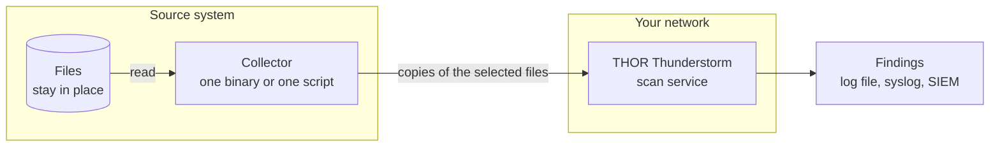

# THOR Thunderstorm, Explained: Scan What You Can't Install On

Last reviewed: **19 October 2026**.

THOR Thunderstorm is Nextron Systems' on-premise scan service. Instead of installing a scanner on a machine, you send copies of that machine's files to the service, and THOR scans them there. The program that does the sending is a **collector**: one binary or one script that needs no installation, leaves no agent behind and needs no THOR license on the device.

That makes the systems that were always off limits to security agents (hypervisor hosts, network appliances, routers, industrial systems, out-of-support machines) part of your investigation, scanned with the same detection content as everything else.

This document is the written companion to the film below. Sections 1 to 7 follow its chapters and cover everything it shows; the sections after them add the details behind it.

## Watch the Film

"Scan what you can't install on": 93 seconds, no sound. The findings shown in it are illustrative.

https://github.com/user-attachments/assets/eb23f1e6-a6b0-4367-a5e1-fa2e93e4b331

## The Short Version

- **The problem.** Some systems cannot run a security agent: hypervisor hosts, network appliances, routers, industrial systems and systems that are out of support. They are still part of your attack surface.
- **The idea.** Do not bring the scanner to the machine. Bring the machine's files to the scanner. A small collector copies selected files to your own THOR Thunderstorm service, and the originals stay where they are.
- **The engine.** THOR does the heavy lifting on your server: YARA rules, your own signatures, IOCs, Sigma rules and forensic parsers. Findings land in a log, in syslog or in your SIEM.
- **The control.** You decide what leaves the machine: recently changed files, under a size limit, of selected types, previewed with a dry run first.
- **The scale.** Run the collector from cron, Ansible or any scheduler on as many hosts as you like. One server analyzes everything it receives.
- **The limits.** A scheduled pass is not real-time monitoring, and coverage is the set of files you select and the collector can read. See [What to Keep in Mind](#what-to-keep-in-mind).

## Contents

- [1. The Blind Spot](#1-the-blind-spot)
- [2. The Idea](#2-the-idea)
- [3. The Collector](#3-the-collector)
- [4. You Decide What Leaves the Machine](#4-you-decide-what-leaves-the-machine)
- [5. The Engine](#5-the-engine)
- [6. The Catch](#6-the-catch)
- [7. At Scale](#7-at-scale)
- [Why This Is Cool](#why-this-is-cool)
- [What to Keep in Mind](#what-to-keep-in-mind)
- [Try It](#try-it)
- [Glossary](#glossary)
- [Further Reading](#further-reading)

## 1. The Blind Spot

Security agents, antivirus products and a local THOR scan all have to run on the machine they protect. Some machines will not take one:

| System | Why a scanner does not fit |
| --- | --- |
| Hypervisor hosts, such as VMware ESXi | Vendor rules |
| Network appliances, such as firewalls, VPN gateways and NAS devices | Closed firmware |
| Routers and IoT devices | Tiny, embedded systems with no room for an agent |
| Industrial systems | No downtime for installing software |
| Out-of-support systems | No agent builds exist for them any more |

In short: no room, no vendor support, or simply no permission. Nextron's [2021 post on ESX](https://www.nextron-systems.com/2021/06/07/analyze-vmware-esx-systems-with-thor-thunderstorm/) describes the same situation: customers often cannot install antivirus or EDR agents on ESX hosts, either because the license agreement forbids it or because the platform is outdated, customized or unsupported.

These systems are still part of your attack surface. Public reports document attacks on edge appliances such as VPN gateways, firewalls and NAS devices; the [collector recommendations](COLLECTOR_RECOMMENDATIONS.md#why-include-these-edge-platforms) list examples. A system that no tool can look into stays a blind spot.

## 2. The Idea

Installing a scanner is the hard part. So skip it: **bring the files to the scanner**.

THOR Thunderstorm is a web service that scans what you send. You run it on a server inside your own network. A collector on (or next to) the source system selects files and sends **copies** to it over HTTP or HTTPS. The originals stay where they are, and the collector only reads the files it sends.



What this changes:

- **Nothing permanent on the device.** No agent, no resident process and no THOR license on the device. A collector runs, uploads and exits.
- **One place for detection content.** Rules, your own signatures and IOCs live on the server, so an update applies to every host that sends files. There is no per-device rollout.
- **Your files stay in your network.** The service is yours and runs on-premise. Copies go to your server, not to a third-party cloud.

## 3. The Collector

A collector reads approved local files and uploads them to Thunderstorm. It does not scan anything itself. Each run is a single pass: it walks the directories you choose, applies its filters, uploads what qualifies, prints a summary and exits.

There are two forms, both published in this repository:

- The **Go collector** is a compiled binary and the recommended starting point for most general-purpose systems with a compatible operating system and CPU. Prebuilt packages exist for dozens of OS and CPU combinations: Linux, Windows, macOS, the BSDs, AIX, Solaris and more. No Go runtime is needed on the target.
- **Eight standalone scripts** cover the cases where a binary is impractical or you want to adapt the logic. Pick the one that matches what the target already has:

| Collector | Needs on the target |
| --- | --- |
| [Bash](../scripts/bash/README.md) | Bash 3.2 or later, plus curl or GNU wget |
| [POSIX sh / ash](../scripts/ash/README.md) | A POSIX shell such as dash or BusyBox ash with standard utilities, and curl, GNU wget or `nc` with `timeout` |
| [Python 3 and Python 2](../scripts/python/README.md) | Python 3.4 or later, or Python 2.7 for legacy hosts; standard library only |
| [Perl](../scripts/perl/README.md) | Perl with LWP 6 or later, JSON::PP and Encode |
| [PowerShell 3+ and PowerShell 2](../scripts/powershell/README.md) | Windows PowerShell 3 or later, or the separate PowerShell 2 file |
| [Batch](../scripts/batch/README.md) | Windows cmd with Windows Script Host and curl 8.4 or later |

The details, including the exact requirements, are in each collector's README and in the [script chooser](../scripts/README.md#choosing-a-collector).

### Which One for What?

The film pairs four example systems with a collector. Here is the current guidance for each. They are examples taken from the collector documentation, not a certification of any product:

| System | Collector to evaluate |
| --- | --- |
| VMware ESXi host | Python 3, or Python 2.7 where required ([ESXi quick start](../scripts/README.md#vmware-esxi-use-the-python-collector)) |
| BusyBox router | POSIX sh / ash |
| Older Citrix NetScaler (FreeBSD 8.4) | Go, using the dedicated FreeBSD 8.4 build ([guidance](../go/README.md#citrix-netscaler-and-freebsd-84)) |
| Older Windows | Go for 32-bit or 64-bit Windows, or PowerShell 2 |

The [collector recommendations](COLLECTOR_RECOMMENDATIONS.md) cover many more products, from Windows, Linux and macOS through VMware and Kubernetes to Cisco, Fortinet, Palo Alto Networks, Citrix, F5, Check Point, Sophos, Ivanti, SonicWall, Synology, QNAP, pfSense, OpenWrt, Nutanix, the BSDs, Solaris and AIX. They are explicit about evidence: unless a test record is linked, a combination is a candidate, not product-tested support.

### What It Looks Like

Often, a shell and a network connection are enough. These are the two commands the film shows (the server name is a placeholder):

```sh
./amd64-linux-thunderstorm-collector -s thunderstorm.example.internal
sh thunderstorm-collector-ash.sh --server thunderstorm.example.internal
```

The first is the Go collector, the second the POSIX sh collector. Neither needs an installation. A collector can be started remotely through Ansible or another automation script, or it can be placed on the system and scheduled with cron or Windows Task Scheduler.

### When Nothing Can Run on the System

Some products allow no execution at all. For those, use **approved external collection**: export or copy the files with the product's documented procedure, then run a collector on a workstation against that directory. This is a workflow, not a built-in remote acquisition mode, and the collector can only upload what it can see and read. The [recommendations](COLLECTOR_RECOMMENDATIONS.md#external-collection-and-file-visibility) explain the boundaries.

### Build Your Own

The upload protocol is small: one HTTP POST per file. The [collector construction guide](COLLECTOR_CONSTRUCTION_GUIDE.md) describes it, along with optional capabilities, safety requirements, acceptance tests and a reusable assignment for a coding agent that targets a new language, OS or architecture. The separate [thunderstormAPI](https://github.com/NextronSystems/thunderstormAPI) Python library is another starting point for custom integrations.

## 4. You Decide What Leaves the Machine

A collector sends only what its filters admit:

| Filter | What it does | Defaults |
| --- | --- | --- |
| Roots and exclusions | Choose the directories to walk and what to leave out | Most collectors have default roots; Batch requires an explicit directory |
| Recently changed | Only files changed in the last N days | Scripts: 30 days since modification. Go: no age cutoff in the bundled configuration; set one with `--max-age` |
| Under a size limit | Skip files above a maximum size | Scripts: 2 MiB. Go: 64 MiB in the bundled configuration (100 MiB built in) |
| Selected file types | Extensions and, in the Go collector, magic headers | Go: the bundled configuration selects types. PowerShell and Batch ship an extension list. The other scripts consider all extensions |

A note on "changed": the scripts look at a file's modification time only. The Go collector accepts a file if any of its timestamps is recent (modification, metadata change and, on some platforms, creation), so a file whose permissions were changed recently also counts as recent.

Some things are skipped by design:

- **Symlinks are not followed.**
- **Network shares and pseudo-filesystems are skipped by default.** The Go collector recognizes them on Linux and macOS (`--all-filesystems` overrides this; on other platforms, use `--exclude`). The scripts skip known system paths, cloud-sync folders, VM artifacts and, on Linux, detected network and special mounts. These are best-effort exclusions, not a security boundary.

### Preview First

Every collector has a dry run: it applies the same filters as a real run, but **nothing is sent**, and no server connection is needed. A dry run checks the selection, not connectivity or whether every file can be read. In the Go collector, add `--debug` to list each file and the reason a file is skipped:

```sh
./amd64-linux-thunderstorm-collector -s thunderstorm.example.internal --dry-run --debug
```

The collectors also say what they are about to do. The Go collector logs which configuration file it loaded (or that it found none and uses its built-in defaults) and a summary of what the run will collect. The scripts print their roots and limits at startup, and the Go collector prints statistics at the end, including how many files were excluded and why.

### Protect the Transfer

The collectors send file contents. Over plain HTTP they are unencrypted, so use HTTPS (`--ssl` in the Go collector, with `--ca` for a private CA) or an isolated network, according to how sensitive the files are. The Thunderstorm manual notes that HTTPS adds transfer time, but it can help where traffic crosses IDS or IPS devices. The collectors have no built-in authentication options, so restrict who can reach the service the way you would for any internal service.

## 5. The Engine

THOR Thunderstorm runs the THOR scanner as a web service. It installs on a server you control (an installer script for Linux, or a container) and accepts files from any device on the network through a REST API. The heavy work, reading rules and matching them against content, happens there and not on the device that sent the file.

What it applies to each file:

| Detection content | What it is |
| --- | --- |
| YARA rules | A large, curated rule set (the product page cites about 30,000 rules) |
| Your own signatures | Custom YARA rules, Sigma rules, hash IOCs and filename IOCs, added on the server |
| IOCs | Indicators of compromise, such as known-bad hashes and file names |
| Sigma rules | Detection rules for log events |
| Forensic parsers | Windows event logs, registry hives, memory dumps and Windows Error Reports, in the default full-featured mode |

The film puts it in one line: even event logs, registry hives and memory dumps. They are parsed when they arrive as files; a collector does not read live memory (see [What to Keep in Mind](#what-to-keep-in-mind)). A pure-YARA mode, which applies only YARA rules, also exists.

### The API in One Table

| Endpoint | Purpose |
| --- | --- |
| `POST /api/checkAsync` | Queue one file; the answer is a receipt with a sample ID. This is what the script collectors always use and what the Go collector uses by default |
| `POST /api/check` | Scan one file and return the findings in the response. Used by the Go collector with `--upload-synchronous` |
| `GET /api/getAsyncResults?id=...` | Status and, once available, the findings of a queued sample |
| `GET /api/status` | Live counters such as scan times and queue length. The Go collector calls it first to confirm the service answers |
| `GET /api/info` | Static details about the instance, such as its version |

Each upload is a `multipart/form-data` request with the file in a field named `file`, plus a `source` query parameter. The source is a label for the sending host (it defaults to the host name) and appears in Thunderstorm's log, so you can tell which machine a finding came from. Some collectors also announce the start and end of a run with an optional marker; services that do not support markers answer 404 or 501, and collection carries on.

### Synchronous and Asynchronous

With **asynchronous** submission, the collector hands each file over, gets a receipt and moves on; the server analyzes the queue in its own time. With **synchronous** submission, the collector waits and shows the findings for every file, which takes longer. In both cases a complete accepted transfer, a completed analysis and a positive detection are three different observations: an accepted upload is not yet a result. Read findings where the service reports them (next section) rather than from the collector's exit status.

## 6. The Catch

This is the moment the blind spot lights up. In the film, a collector sends recent files from a host called `esxi-01`, and Thunderstorm reports two findings:

| Host | File | What THOR flags |
| --- | --- | --- |
| esxi-01 | `/tmp/shell.jsp` | A web shell: a script that lets an attacker run commands through a web server |
| esxi-01 | `/root/.bash_history` | A command that opens a reverse shell: a connection from the host back to the attacker |

**These findings are illustrative.** They are not a live detection and not an exact API response. They echo the demo in the [2021 ESX post](https://www.nextron-systems.com/2021/06/07/analyze-vmware-esx-systems-with-thor-thunderstorm/), where a web shell in `/tmp` and a back-connect command in the root account's shell history show up the same way.

Findings land where you already look:

- **A log file** on the Thunderstorm server (on Linux, `/var/log/thunderstorm/thunderstorm.log`).
- **Syslog**, forwarded to your SIEM with a `syslog` entry in the service configuration.
- **The collector itself**, if you use synchronous submission.

Thunderstorm can write text, JSON and syslog output. Its web page and `/api/status` show counters and the queue length. A server option controls whether samples are stored after analysis (none, only malicious ones, or all).

## 7. At Scale

One server, many hosts: every collector labels its uploads with its own source name, and Thunderstorm scans whatever arrives.

**Run it every night and ship only what changed.** Start the collector from cron, Ansible, Windows Task Scheduler or whatever scheduler you already use, with an age filter so each pass covers only recently changed files. Make the window a little longer than the interval, so nothing falls between two runs; the overlap means some files are sent twice, because collectors do not deduplicate. A cron entry for the Go collector looks like this. It changes into the package directory first, because the collector reads `config.yml` from the current working directory:

```cron
30 2 * * * cd /opt/thunderstorm-collector && ./amd64-linux-thunderstorm-collector -s thunderstorm.example.internal --max-age 25h
```

**Capacity is a server question.** Analysis time depends on the rule set, the mix of files and the hardware. The Thunderstorm manual gives a rule of thumb of roughly 250 samples per core per minute on recommended hardware; treat it as approximate. Start with a small collection, watch the server's load and queue, and widen the scope step by step. On the sending side, the Go collector has `--threads` and `--uploads-per-minute` to control pressure, and all collectors back off and retry a bounded number of times when the server answers busy (HTTP 503).

**Scheduled collection is not real-time monitoring.** Between two passes, nothing watches the system.

## Why This Is Cool

- **It reaches what agents cannot.** Hypervisors, appliances, routers, industrial systems and out-of-support machines become scannable.
- **Nothing to install, nothing left behind.** A collector is one binary or one script that runs, uploads and exits. A script that needs scratch files keeps them in a temporary directory and removes them on exit.
- **One brain for every system.** Detection content is maintained in one place, including your own signatures, and every host that sends files benefits from an update at once.
- **Light on the source.** The expensive analysis runs on your server. The device only walks, filters and sends, and metadata filters rule files out without reading their full contents.
- **Your data stays in your network.** The service runs on-premise, under your control.
- **You stay in control of what leaves.** Filters, exclusions and a dry run decide it, and the collectors say what they are about to do.
- **Simple to start and to automate.** One command with a server name starts a collection; cron, Ansible or Task Scheduler repeat it.
- **Deep file understanding.** THOR's forensic parsers mean that event logs, registry hives and memory dumps exported as files are analyzed, not just executables and scripts.
- **Findings where you already look.** A log, syslog or your SIEM.
- **Collectors you can read, adapt and replace.** Their source is published here, the upload protocol is documented, and the construction guide explains how to build a collector for a platform that is not covered.

## What to Keep in Mind

- **Prefer direct THOR scanning where you can.** Where a system is supported and local scanning is permitted, run THOR itself: a file collector does not reproduce all of its endpoint-scanning capabilities. Nextron has announced Windows ARM64 and Linux ARM64 support with the upcoming THOR 11, which will reduce the need for collectors on those systems. Collectors remain useful for legacy systems, appliances, other architectures and central file-analysis workflows. See [Direct THOR Scanning and ARM64](COLLECTOR_RECOMMENDATIONS.md#direct-thor-scanning-and-arm64).
- **Scheduled, not real-time.** A collection is a pass. It finds what is on disk when it runs, not what happened in between.
- **Files only.** A collector reads files. It does not inspect running processes, live memory or network traffic, and it can only upload files it can see, read and has not filtered out. Run it with enough privileges for the scope you want, and review the filters.
- **Not a snapshot.** Files can change while a pass runs, and the collectors do not prevent a hostile change or replacement during collection.
- **No installation is not the same as permission.** A collector avoids installation and leaves no agent behind, but it still has to run, and vendor policy or your own rules may forbid that. Confirm what is permitted first, and use approved external collection where it is not.
- **Platform support varies.** The binaries and scripts have different requirements, and not every build has been tested on every platform. Check the [recommendations](COLLECTOR_RECOMMENDATIONS.md) and the collector's README for the exact system.
- **Accepted is not analyzed.** With asynchronous submission, a successful upload only means the server accepted the file. Check results on the service.
- **A detection is a lead.** Findings tell you where to look; they need the usual investigation.
- **Plan the server.** The service does the analysis, so size it for the files you send and protect it like any internal service that receives file contents.
- **The film is a story, not a spec.** Its findings are illustrative, and the pairings it shows are examples.

## Try It

You need a Thunderstorm service and a collector.

1. **Set up the service.** Follow the [THOR Thunderstorm setup guide](https://thor-thunderstorm-setup-guide.nextron-systems.com/en/latest/) (installer script or container). The collectors default to port 8080.
2. **Pick a collector.** Download the Go package for your OS and CPU from [Releases](https://github.com/NextronSystems/thunderstorm-collector/releases), or one script from the [script chooser](../scripts/README.md#choosing-a-collector). The [main README](../README.md) has the download details.
3. **Preview.** Run a dry run against a small directory and read what it would send:

   ```sh
   ./amd64-linux-thunderstorm-collector -s thunderstorm.example.internal -p /var/www --dry-run --debug
   ```

   The POSIX sh collector works the same way (on BusyBox, start it with `busybox ash`):

   ```sh
   sh ./thunderstorm-collector-ash.sh --server thunderstorm.example.internal --dir /var/www --source my-device --dry-run
   ```

4. **Send it.** Run the same command without `--dry-run` (for the POSIX sh collector, use `--no-dry-run`).
5. **Look at the results.** On the Thunderstorm server (Linux):

   ```sh
   tail -f /var/log/thunderstorm/thunderstorm.log
   ```

6. **Schedule it.** Add the collector to cron, Windows Task Scheduler or your automation, as shown in [At Scale](#7-at-scale).

For assessments with a defined scope, the [Emerging Threats guides](../emerging-threats/README.md) list which files and directories to collect; the first one covers Citrix NetScaler. Product-specific deployment guides are in [Product Integration Guides](../integration-guides/Readme.md).

## Glossary

| Term | Meaning |
| --- | --- |
| **THOR** | Nextron Systems' scanner for finding traces of attacker activity on systems and in files |
| **THOR Thunderstorm** | THOR as a web service: you submit files over HTTP and it scans them on a server you run |
| **Collector** | A small program or script that selects files on a system and uploads copies to Thunderstorm |
| **Sample** | A file submitted to Thunderstorm for analysis |
| **Source** | The label that identifies the sending host in Thunderstorm's log; it defaults to the host name |
| **YARA** | A rule language for describing patterns in files and memory |
| **Sigma** | An open, vendor-neutral format for detection rules on log events |
| **IOC** | Indicator of compromise, such as a file hash or file name linked to known malicious activity |
| **SIEM** | Security information and event management system, where logs and alerts are collected |
| **Dry run** | A run that selects files but sends nothing |
| **Asynchronous / synchronous submission** | The service queues the file and returns a receipt, or scans it and returns the findings in the same request |
| **Web shell** | A script that gives an attacker remote command execution through a web server |
| **Reverse shell** | A connection that the compromised host opens back to the attacker, who then gets a command line |

## Further Reading

In this repository:

- [Main README](../README.md): collector selection, downloads and the quick start
- [Go collector guide](../go/README.md): configuration, filtering, platform compatibility and exit status
- [Script collectors](../scripts/README.md): which script for which runtime, and the ESXi quick start
- [Collector recommendations](COLLECTOR_RECOMMENDATIONS.md): products and platforms, and the evidence behind each recommendation
- [Collector construction guide](COLLECTOR_CONSTRUCTION_GUIDE.md): the upload protocol, and how to build a collector for another platform
- [Emerging Threats](../emerging-threats/README.md) and [Product Integration Guides](../integration-guides/Readme.md)
- [Testing overview](COLLECTOR_TESTING_OVERVIEW.md) and the [script acceptance report](SCRIPT_COLLECTOR_ACCEPTANCE_2026-10-08.md)

From Nextron Systems:

- [THOR Thunderstorm product page](https://www.nextron-systems.com/thor-thunderstorm/)
- [Setup guide: next steps](https://thor-thunderstorm-setup-guide.nextron-systems.com/en/latest/usage/next-steps.html) and [API reference](https://thor-thunderstorm-setup-guide.nextron-systems.com/en/latest/usage/api.html)
- [Analyze VMware ESX systems with THOR Thunderstorm](https://www.nextron-systems.com/2021/06/07/analyze-vmware-esx-systems-with-thor-thunderstorm/) (2021)
- [thunderstormAPI](https://github.com/NextronSystems/thunderstormAPI), a Python library and command-line client for submitting files
